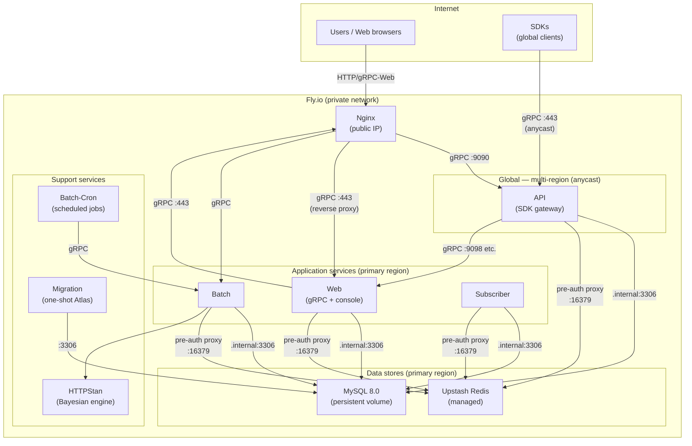
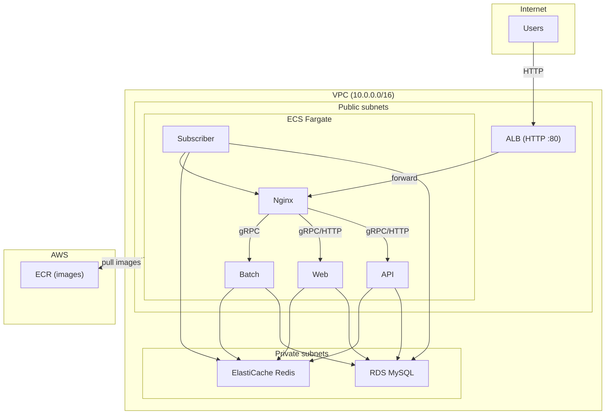

# Bucketeeraform

Terraform and config to run [Bucketeer](https://github.com/bucketeer-io/bucketeer) (A/B testing and feature flags) lite version on **AWS** (ECS Fargate, RDS MySQL, ElastiCache Redis) or **Fly.io** (Machines, self-hosted MySQL, Upstash Redis).

---

## Fly.io

### Architecture



- **API** is deployed globally across multiple regions (configurable via `API_REGIONS`). It has its own public anycast IP -- Fly.io automatically routes SDK clients to the nearest region for low-latency feature flag evaluations.
- **Nginx** has a separate public IP and serves the web console / gRPC-Web traffic. All other services communicate over Fly.io's private `.internal` DNS.
- **Redis** is managed by Upstash (provisioned via `fly redis create`). Each service runs a local `socat` pre-auth proxy on `:16379` because Bucketeer v2.2.0 binaries do not support Redis password authentication natively.
- **MySQL** runs as a self-hosted container with a persistent Fly volume in the primary region.
- **TLS** uses a self-signed cert generated at deploy time (`make gen-certs-flyio`) with SANs for both short names and `.internal` hostnames.
- **Migration** runs as a one-shot Fly Machine using Atlas.

### Estimated cost (Fly.io)

All machines run `shared-cpu-1x`. Prices assume 24/7 uptime in a single region.

| Resource | Spec | Qty | Est. $/mo |
|---|---|---|---:|
| MySQL | shared-1x, 1024 MB | 1 | ~$7 |
| Web | shared-1x, 512 MB | 1 | ~$5 |
| API | shared-1x, 256 MB | 1 | ~$3 |
| Batch | shared-1x, 256 MB | 1 | ~$3 |
| Subscriber | shared-1x, 256 MB | 1 | ~$3 |
| Nginx | shared-1x, 256 MB | 1 | ~$3 |
| HTTPStan | shared-1x, 256 MB | 1 | ~$3 |
| Batch-Cron | shared-1x, 256 MB | 1 | ~$3 |
| Migration | shared-1x, 512 MB | one-shot | ~$0 |
| Volume | 1 GB SSD | 1 | ~$0.15 |
| IPv4 addresses | dedicated (nginx + api) | 2 | $4 |
| Upstash Redis | Pay-as-you-go | 1 | $0 base |
| | | **Total** | **~$34/mo** |

> Fly.io includes a [free allowance](https://fly.io/docs/about/pricing/) (3 shared-cpu-1x 256 MB VMs, 3 GB volume storage). With the free tier applied the effective cost is closer to **~$25/mo**. Adding more API regions costs ~$3/region. Upstash Redis is free up to 10k commands/day; beyond that it is $0.20 per 100k commands.

### Guidelines to run (Fly.io)

#### 1. Prerequisites

- [flyctl](https://fly.io/docs/flyctl/install/) installed and authenticated (`fly auth login`).
- [Docker](https://docs.docker.com/get-docker/) for building images.
- [OpenSSL](https://www.openssl.org/) for generating TLS certs (available by default on macOS/Linux).

#### 2. Configure

```bash
cp flyio/config.env.example flyio/config.env
```

Edit `flyio/config.env`: set `REGION`, `MYSQL_PASSWORD`, `MYSQL_ROOT_PASSWORD`, `API_REGIONS` (comma-separated list of regions for the global API), and optionally `APP_PREFIX` / `OAUTH_ISSUER`.

#### 3. Deploy everything

A single command handles cert generation, Redis provisioning, image builds, infrastructure, migrations, and service deployment:

```bash
make deploy-flyio
```

The script is idempotent -- re-running it updates existing resources rather than duplicating them.

#### 4. Get the public IPs

```bash
make ip-flyio
```

This shows two IPs:
- **Nginx IP** -- for the web console and gRPC-Web traffic. Point your web domain here.
- **API IP** -- anycast IP for SDK clients. Fly.io routes to the nearest API region automatically. Point your SDK/API domain here.

#### 5. View logs

```bash
make logs-flyio                       # web service logs
fly logs -a bucketeer-api             # api logs
fly logs -a bucketeer-subscriber      # subscriber logs
```

#### 6. Access the database

```bash
fly proxy 3306:3306 -a bucketeer-mysql   # then connect with any MySQL client on localhost:3306
```

#### 7. Tear down

```bash
make destroy-flyio
```

This destroys all Fly apps and the Upstash Redis instance.

---

## AWS

### Architecture




- **ALB** is the single entry point; it forwards to **Nginx**, which routes to API, Web, and Batch.
- **ECS** tasks (Nginx, API, Web, Batch, Subscriber) run in public subnets with Cloud Map service discovery (`*.bucketeer.local`).
- **RDS** and **ElastiCache** live in private subnets; ECS reaches them over the VPC. RDS is set publicly accessible for Query Editor; restrict the security group in production.
- **ECR** holds the container images used by ECS.

### Estimated cost (AWS)

Default config uses the smallest instance types. Prices are for `us-east-1`.


| Resource                 | Spec                | Qty       | Est. $/mo   |
| ------------------------ | ------------------- | --------- | ----------- |
| ECS Fargate (Nginx)      | 0.25 vCPU, 512 MB   | 1 task    | ~$9         |
| ECS Fargate (API)        | 0.25 vCPU, 512 MB   | 1 task    | ~$9         |
| ECS Fargate (Web)        | 0.25 vCPU, 512 MB   | 1 task    | ~$9         |
| ECS Fargate (Batch)      | 0.25 vCPU, 512 MB   | 1 task    | ~$9         |
| ECS Fargate (Subscriber) | 0.25 vCPU, 512 MB   | 1 task    | ~$9         |
| ALB                      | application         | 1         | ~$16        |
| RDS MySQL                | db.t3.micro, 20 GB  | 1         | ~$15        |
| ElastiCache Redis        | cache.t3.micro      | 1         | ~$12        |
| Secrets Manager          | 1 secret            | 1         | ~$0.40      |
| CloudWatch Logs          | 7-day retention     | —         | ~$0         |
| NAT Gateway              | disabled by default | 0         | $0          |
|                          |                     | **Total** | **~$79/mo** |


> **AWS Free Tier** (first 12 months of a new account): RDS db.t3.micro (750 hrs/mo) and ElastiCache cache.t3.micro (750 hrs/mo) are free, bringing the effective cost down to **~$52/mo**. After the free tier expires the full ~$79/mo applies. Enabling a NAT Gateway adds ~$32/mo.

---

### Guidelines to run (AWS)

#### 1. Prerequisites

- [Terraform](https://www.terraform.io/downloads) installed.
- [AWS CLI](https://aws.amazon.com/cli/) configured (or use access keys in `config.tfvars`).
- [Docker](https://docs.docker.com/get-docker/) for building and pushing images.

#### 2. Configure Terraform

```bash
cp aws/terraform-config/config.tfvars.template aws/terraform-config/config.tfvars
```

Edit `aws/terraform-config/config.tfvars`: set `aws_region`, `app_name`, `db_password`, and optionally `aws_access_key_id` / `aws_secret_access_key`.

#### 3. Deploy infrastructure

```bash
make init-aws
make plan-aws
make apply-aws
```

#### 4. Build and push images

Config (and certs) are baked into images at build time. From repo root:

```bash
make push-aws
```

#### 5. Run database migrations

```bash
make migrate-aws
```

#### 6. Roll out the new images (optional)

If you already had services running and just pushed new images:

```bash
make deploy-aws
```

#### 7. Get the app URL

```bash
cd aws/modules && terraform output -raw app_url
```

Open that URL in a browser (HTTP). The same base URL is used for the web UI and the API (e.g. `/v1/gateway`).

#### 8. Tear down (optional)

```bash
make destroy-aws
```

---

## Certs

The `**certs/**` folder in this repo is **for example / local development only**. It typically contains:

- `tls.crt`, `tls.key` — TLS for services and Nginx.
- `service-token` — service-to-service auth token.
- `oauth-public.pem`, `oauth-private.pem` — OAuth keys for the web app.

These files are copied into Docker images when you run `make push-aws`. For real environments you should:

- **Not** commit real secrets or production certs.
- Generate or obtain proper certificates and tokens and place them in `certs/` (or override via env at runtime where supported) before building images.
- Keep `config.tfvars` and any secret files out of version control (e.g. via `.gitignore`).

---

## Quick reference

### Fly.io


| Make target          | Purpose                                                                  |
| -------------------- | ------------------------------------------------------------------------ |
| `deploy-flyio`       | Full deploy: gen certs, create Redis, build images, deploy all services. |
| `gen-certs-flyio`    | Regenerate TLS cert with Fly.io `.internal` SANs.                        |
| `create-redis-flyio` | Provision Upstash Redis (idempotent).                                    |
| `destroy-flyio`      | Destroy all Fly apps and Upstash Redis.                                  |
| `ip-flyio`           | Show public IPs for the Nginx app.                                       |
| `logs-flyio`         | Tail logs for the web service.                                           |


### AWS


| Make target   | Purpose                                                                               |
| ------------- | ------------------------------------------------------------------------------------- |
| `init-aws`    | Terraform init in `aws/modules`.                                                      |
| `plan-aws`    | Terraform plan.                                                                       |
| `apply-aws`   | Terraform apply (create/update infra).                                                |
| `push-aws`    | Build images (with config + certs) and push to ECR.                                   |
| `deploy-aws`  | Force new deployment of all ECS services (use after push-aws to roll out new images). |
| `migrate-aws` | Run pre-migration SQL fix and Atlas DB migrations (with one retry on failure).        |
| `destroy-aws` | Destroy AWS resources.                                                                |


For more detail (migration, subscriber, RDS Query Editor, etc.) see [aws/README.md](aws/README.md).